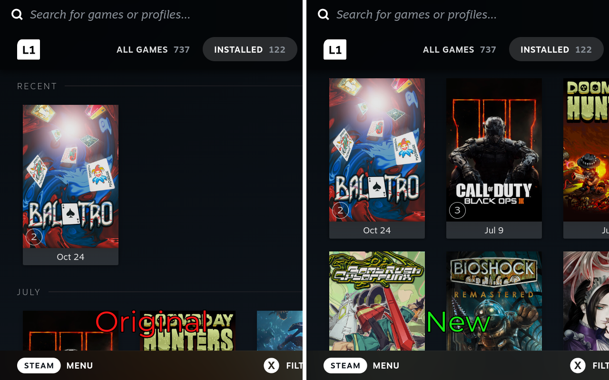
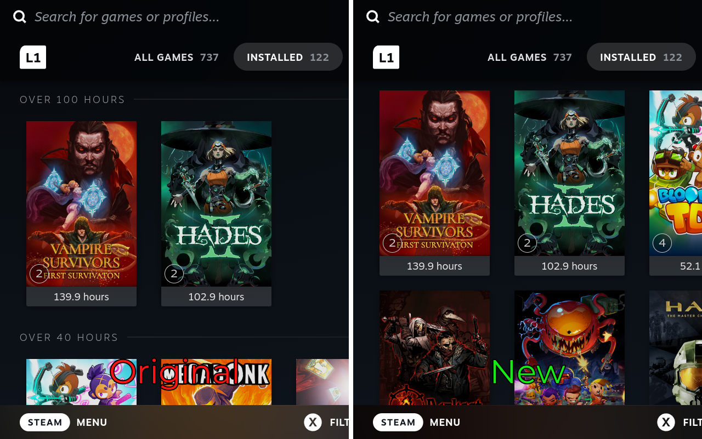

# No Library Groups

No Library Groups is a Decky Loader plugin for the Steam Deck that removes the groups from the library sorts.

Sorting the library by Last Played splits it into sections such as Recent, July and 2025, and every section starts a new row. With the plugin on, the order stays the same and the games run as one continuous grid, the way Alphabetical does.

##
Each sort can be toggled on its own from the Quick Access Menu
* Last Played
* Hours Played
* Release Date
* Size on Disk
* Metacritic Score
* Steam Review

## Preview

### Last Played

### Hours Played

